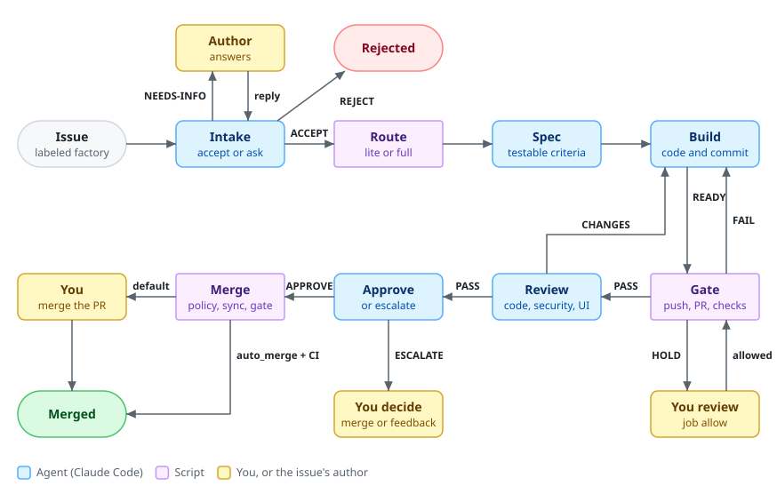
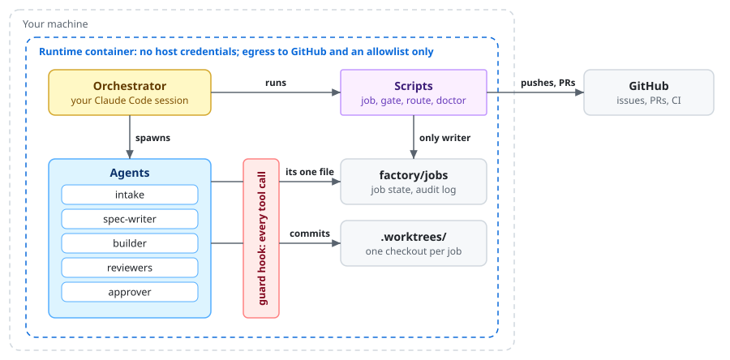
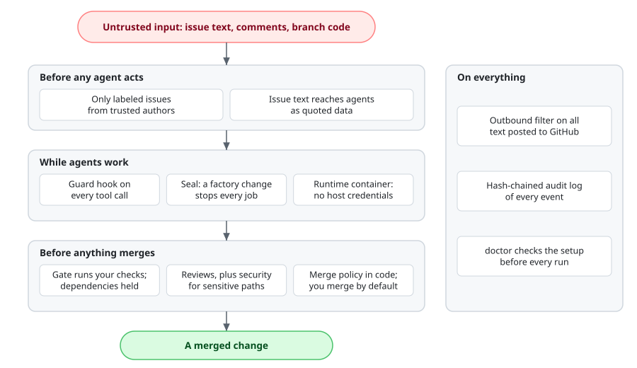

# Software Factory for Claude Code

The factory works through your repository's GitHub issues. Label an issue
`factory`, run `/factory run` in Claude Code, and a team of agents decides
whether it's worth building, writes a spec, builds it, tests it with your
project's own checks, reviews it, and opens a pull request that closes the
issue. Scripts, not agents, make every decision that matters: what moves where,
what gets pushed, and what merges. By default a human merges every PR.

| | |
|---|---|
| **What it's for** | Turning small, well-scoped GitHub issues into reviewed PRs through a fixed, auditable pipeline. |
| **Where it runs** | On your machine, in one Claude Code session per repository, ideally inside its runtime container. It never deploys. |
| **Who merges** | You. Unattended merges are off unless you turn on `auto_merge`, and even then they're limited by risk, paths and CI. |
| **Status** | Pre-pilot. The test suite and CI pass and the guard has run live in Claude Code, but the whole pipeline hasn't yet run on a real repository. [`PILOT.md`](PILOT.md) is the next step. |
| **Owner** | The repository owner (GitHub: Muhammad-UmairAli) approves changes to the defaults, the guard and the agents; see [`.github/CODEOWNERS`](.github/CODEOWNERS). |
| **License** | GPLv3, a modified version of an open-source GPLv3 project. See [License](#license). |

## Is it safe to use?

Yes, for an internal repository, if you run it the recommended way. It isn't
ready for client repositories yet: that waits on a live pilot and on your
organization's own security and legal review.

**What's in place.** Every agent tool call passes through a guard hook. The
factory's own files are sealed, so a change to them stops every job. The gate
runs your checks from your main checkout, never the branch's copy, and holds
dependency changes for you before anything installs them. Everything posted to
GitHub is filtered for credentials. Sensitive paths always reach a human. Every
job event and guard decision lands in a tamper-evident log. The details are in
[Security model](#security-model).

**What you must do.**

1. Run it in the [runtime container](#runtime-container), which holds none of
   your machine's credentials and can only reach GitHub and an allowlist.
2. Give it a fine-grained GitHub token for that one repository, never a login
   that reaches all your repositories. `doctor` refuses the latter.
3. Keep `auto_merge` off until your pilot says otherwise, and review every PR
   as you would a colleague's.
4. Keep `concurrency` at 1, and turn on branch protection if your GitHub plan
   offers it.

**What it doesn't cover.** The guard is a pattern check, not a sandbox: code an
agent writes and then runs can do whatever the container allows, including
using its one GitHub credential. Text in an issue can still steer what an agent
writes, which is why reviews and your merge are the last line. The session you
run `/factory` in is yours and isn't guarded. [DESIGN.md](DESIGN.md#security-model)
lists every known limit.

## How a job flows

<picture>
  <source media="(prefers-color-scheme: dark)" srcset="docs/images/job-flow-dark.svg">
  
</picture>

- **Two profiles.** Low risk runs lite: intake's acceptance criteria become the
  spec, one code reviewer looks, the script approves, and a human always
  merges. Medium and high risk run full: every agent, every step. A branch that
  touches login, permissions, payments or secrets code switches to full and
  gets a security review whatever intake decided.
- **Limits.** A job gets `max_rounds` build rounds (3) and `max_cost_usd_per_job`
  ($20). When either runs out, it goes to you instead of another round.
- **Waiting is safe.** State lives in `factory/jobs/`, so a session that dies
  loses nothing: run `/factory run` again and every job resumes from its stage.

## How it's built

<picture>
  <source media="(prefers-color-scheme: dark)" srcset="docs/images/architecture-dark.svg">
  
</picture>

| Part | What it is | What it may do |
|---|---|---|
| **Orchestrator** | The `/factory` skill in your Claude Code session | Spawns agents and runs the scripts, one job per `concurrency` slot. |
| **Agents** | Claude Code subagents in `.claude/agents/` | Read the repository; each writes exactly one file in the job's folder. The builder also edits and commits in the job's worktree. None of them push or touch GitHub. |
| **Guard** | `factory/bin/guard`, a PreToolUse hook on every agent | Blocks secret reads, GitHub writes, pushes, writes outside the agent's job, and changes to the factory. Fails closed. |
| **Scripts** | `factory/bin/` | `job` is the only writer of job state and the only thing that pushes, opens PRs and merges. `gate` runs your checks. `route` picks agents and models. `doctor` checks the setup. |
| **State** | `factory/jobs/` (gitignored) | One folder per job: its files, its audit trail, its rounds. |

[DESIGN.md](DESIGN.md) explains each choice and the alternatives.

## Quick start

**You need:** macOS or Linux (Windows through WSL2, untested); Claude Code
2.1.257 or later; Python 3.10 or later (the scripts use only the standard
library); `git`; [`gh`](https://cli.github.com/); and Docker for the runtime
container.

```bash
# 1. Get the factory, pinned to a release tag, next to your project.
git clone https://github.com/Muhammad-UmairAli/claude-software-factory.git software-factory

# 2. See what the setup command would do, then do it. Name the factory's owners for CODEOWNERS.
software-factory/install ~/code/my-project --dry-run
software-factory/install ~/code/my-project --owner @you
```

`install` refuses anything but a clean git repository, never overwrites a
file, and never commits. It copies the factory in, drafts
`factory/checks.sh` from your project's own files (`package.json`,
`pyproject.toml`, `go.mod`, `Cargo.toml` or a Makefile), writes
`factory/project.md` for your project's facts, sets the base branch, adds two
lines to `.gitignore`, a short section to `AGENTS.md` and, with `--owner`, a
CODEOWNERS entry for `factory/` and `.claude/`, then runs `doctor`. It records
the release in `factory/VERSION` and a hash of every file it placed in
`factory/install.json`. Then:

```bash
cd ~/code/my-project
bash factory/checks.sh          # the drafted checks must pass on your main branch; fix them if not
git switch -c add-software-factory
git add -A && git commit -m "Add the software factory"
# Open a PR, review it, merge it: jobs branch from origin/<base>, so the install must be there.

factory/bin/runtime build       # the container, once
factory/bin/runtime shell       # then, inside it:
#   gh auth login                 with a fine-grained token for this repository only
#   claude                        accept the folder trust prompt; the guard hooks need it
#   factory/bin/doctor            fix every FAIL
```

Create the four labels (`install` prints the commands, or run it with
`--create-labels`), label a small issue `factory`, and in Claude Code run
`/factory run`. [INSTALL.md](INSTALL.md) covers the parts that need judgment:
your project's facts in `factory/project.md` (what it's for, its security hot
spots, its design system, its users, what must always reach a human),
`sensitive_paths`, and Claude Code settings.

**Upgrading.** From a copy of the new release, `install --upgrade
~/code/my-project` replaces the factory's files you haven't changed, keeps the
ones you have (and prints a `diff -u` for each), and never touches
`config.json`, `checks.sh` or `project.md`. `install --uninstall` takes out
what the installer put in, except your changes. Both take `--dry-run`, and
neither commits.

## Using it

```text
/factory run          preflight, then work through every open `factory` issue; also resumes
/factory run <n>      one issue now
/factory <anything>   ask about jobs, give feedback on a PR, or file a feature
```

You approve by merging the PR on GitHub. To change a PR that waits on you, tell
the factory what you want with `/factory`. Scripts you can run yourself:

```bash
factory/bin/doctor             # preflight: config, agents, token, labels, branch protection, audit log
factory/bin/job summary        # every job: stage, PR, cost, time
factory/bin/job show 12 decision.md  # a job file's verdict and summary, framed as data (--full for all)
factory/bin/job history 12     # one job's audit trail
factory/bin/job cancel 12      # stop issue 12's job in any stage (reason on stdin)
factory/bin/job pause          # stop new work (reason on stdin); job resume lifts it
factory/bin/job allow 12       # approve the dependency files the gate held
factory/bin/job audit          # check the audit log's hash chain; what happened each day
factory/bin/job audit ship     # send new audit records to your collector
factory/bin/job metrics        # cost, time, rework and size per job, as CSV
factory/bin/job seal           # fingerprint the factory's files (/factory run does this)
factory/bin/job verify         # check them against the seal
```

## Configuration

Everything lives in `factory/config.json`. The defaults are the safe ones.

| Setting | Default | Why |
|---|---|---|
| `concurrency` | `1` | Read every PR until you trust the factory. Above 1, two jobs can share a stage, and an agent could write into the other job's files. |
| `auto_merge.enabled` | `false` | A human merges every PR. When on, only full-profile PRs at or below `max_risk` merge unattended; lite PRs always wait, and `doctor` says which risks a setting covers. |
| `ci` | wait up to 30 minutes, at least 60 seconds after the push | An unattended merge waits for your repository's own CI on the gated commit; a failure, a timeout or a missing `required_checks` name sends the job to you. |
| `escalate_paths` | CI, infrastructure, dependency manifests, migrations, agent instructions, developer tool configs | These always go to a human, whatever the approver says. |
| `sensitive_paths` | access control, identity, sessions, tokens, secrets, crypto, payments, webhooks | A branch that touches one gets the security reviewer, the full profile and a `high` risk floor. Broad on purpose: a false match costs one extra review. |
| `hold_paths` | dependency manifests, lockfiles, package-manager configs | The gate runs nothing until you approve them (`job allow`): installing them runs code nobody has reviewed. A later change is held again. |
| `protected_paths` | the factory's own files, agent and settings files, `.git/` | The gate fails any branch that adds, changes or deletes them. |
| `issue_authors` | `collaborators` | Only authors with triage or write access get work into the factory. |
| `max_rounds`, `max_cost_usd_per_job` | `3`, `20` | A job that runs out goes to a human instead of another round. |
| `checks.env_allowlist`, `checks.timeout_sec` | toolchain variables only, `1800` | Branch code under test gets no tokens from the environment, and a hung test can't stall the gate. |
| `audit` | 10 MB files, kept 365 days, no collector | Set `forward_url` to keep a copy of the log off the machine. |
| `github_app` | not set | Optional: a GitHub App instead of a token, for one-hour credentials and a bot identity ([RUNBOOK.md](RUNBOOK.md#github-credentials)). Set `slug` (the App's name in its URL) to skip a lookup, and `operator` (your GitHub login) so your own replies on an issue reach the agents. |
| `models` | `opus` for intake, spec, builder and approver | Every model choice lives here; see [Cost](#cost). |
| `profiles` | low → `lite`, medium and high → `full` | Change the mapping once your own benchmark says where each pays off. |
| `sizing` | 8 files, 400 changed lines | Intake rescopes anything bigger; the gate reports a change's real size. |
| `prices_owner`, `prices_checked` | not set, the release date | Who compares `prices_usd_per_mtok` with the published prices each month, and when they last did. `doctor` warns when no one is named or the check is over 31 days old. |

## Security model

<picture>
  <source media="(prefers-color-scheme: dark)" srcset="docs/images/security-layers-dark.svg">
  
</picture>

| It protects against | It doesn't protect against |
|---|---|
| Agents reading `.env` files, keys and credential folders, or printing tokens, in the forms the guard knows | Code an agent writes and then runs: it can do anything the container allows, including using its one GitHub credential |
| Agents pushing, opening or merging PRs, or changing labels: only the scripts do that | Issue text steering what an agent writes: reviews and your merge are the backstop |
| Anything changing the factory, git's config or hooks mid-run (seal) | The orchestrator session, which is yours and unguarded |
| A branch changing the checks it's judged by, or installing unreviewed dependencies during the gate | Two jobs at once (`concurrency` above 1) writing into each other's files |
| Credentials leaking through comments, PR titles or bodies (outbound filter) | Credentials the filter's patterns don't recognize |
| Unreviewed or unexpected merges (human merge by default, exact gated commit, CI) | A repository without branch protection, where anyone with access can push directly |
| Quiet edits to the audit trail (hash chain; ship it off the machine to catch truncation) | Anything on your host outside the container, if you run the factory outside it |

[DESIGN.md](DESIGN.md#security-model) describes each control and every known
limit. Report a vulnerability as [SECURITY.md](SECURITY.md) says.

## Runtime container

`factory/bin/runtime` runs the factory in a Docker container that holds none of
your machine's credentials: no SSH agent, no `~/.gitconfig`, no cloud logins.
Its outbound traffic is limited to GitHub's published address ranges and the
hosts in `factory/runtime/egress-allowlist`. It starts as root only long enough
to install that firewall, checks it both ways, then runs as an unprivileged
user that can't get root back. CI builds the image and checks all of that on
every change to it.

```bash
factory/bin/runtime build      # once, and after any change under factory/runtime
factory/bin/runtime shell      # inside: gh auth login, claude, /factory run
```

Use the launcher, not an editor's dev-container feature: VS Code's Dev
Containers extension forwards your SSH agent, git credentials and
`~/.gitconfig` into a container by default. If `checks.sh` installs packages
from anywhere but npm or PyPI, add those hosts to the allowlist (through
review) and rebuild.

## Operating it

[RUNBOOK.md](RUNBOOK.md) covers the routine and every refusal the factory can
print: what it means and what to do. The short version:

- **Stop everything:** `factory/bin/job pause`, then end the session. Cancel a
  job with `factory/bin/job cancel <n>`.
- **Something changed the factory:** every job command stops with "control
  files changed since `job seal`". Find out what changed before re-sealing.
- **The audit log:** `factory/bin/job audit` checks it; `doctor` fails if its
  chain is broken.
- **Dashboard:** `factory/bin/dashboard`, then open the link it prints. It
  listens on `127.0.0.1` only and answers only requests that carry the
  link's token and name `127.0.0.1` or `localhost`, which stops another web
  page from reading job files through DNS rebinding. It serves the board and
  the job folders, never config, scripts or the audit log. Inside the
  container, run `factory/bin/dashboard --bind 0.0.0.0`; the launcher
  publishes the port on `127.0.0.1` only.

## Cost

Cost is the API-equivalent price of each job's agents, read from Claude Code's
transcripts and priced with `prices_usd_per_mtok`. On a subscription plan it
shows where the spend goes, not what you're billed. `max_cost_usd_per_job`
counts a job's agents only, so a job's budget can't move because another job
shared its session.

- **The orchestrator.** Each session that ran factory agents is a run, and its
  own tokens are shared evenly by the jobs it worked on: `job summary` totals
  them per run, and `job metrics` gives each job's share as
  `orchestrator_usd`. Run the factory in its own session (the runtime container
  does), or your other work in that session counts too.
- **When transcripts stop parsing.** The transcript format isn't a documented
  interface. Lines or usage records the factory can't read are counted, not
  skipped quietly: the job command, `job summary` and `doctor` then say the
  cost may be low, and the job's audit trail records it once. Check against
  your usage before you trust the budget.
- **The prices.** `prices_owner` names who compares the table with the
  published prices every month and records the date in `prices_checked`;
  `doctor` warns when no one is named or the check is over 31 days old.

Fable is the most capable model and costs about 2.5 times Opus per token. Set
`models.intake` to `fable` if intake's accept, reject and rescope calls need
it; on some plans Fable bills to usage credits.

## Pilot and benchmark

Don't take the factory's value on faith. [PILOT.md](PILOT.md) is the plan for a
first live run on 8 to 12 real tickets in an internal repository: setup, a
ticket mix that walks every control path, stop rules and exit criteria.
[BENCHMARK.md](BENCHMARK.md) compares a single Claude prompt, factory-lite and
factory-full on the same tickets, scored blind against acceptance tests
written up front.

## What's in here

```text
install                       the setup command: install, --upgrade or --uninstall a project
prompts/                      the agents' prompts: one source per agent plus shared blocks; build.py writes .claude/agents/
.claude/
  skills/factory/SKILL.md     the orchestrator: preflight, queue, concurrency, the pipeline
  agents/                     intake, spec-writer, builder, reviewer-{code,security,ux,ui}, approver
factory/
  config.json                 every setting above
  checks.sh                   your repository's checks (install drafts it)
  project.md                  your project's facts, which the agents read (install writes the headings)
  VERSION, install.json       the release, and the hash of every file install placed
  bin/job                     the only writer of job state; refuses illegal moves; pushes, opens PRs, merges
  bin/gate                    runs checks.sh in a job's worktree
  bin/route                   risk and surfaces → the job's reviewers and models
  bin/guard                   every agent's PreToolUse hook
  bin/doctor                  preflight checks
  bin/runtime                 builds and enters the runtime container
  bin/dashboard               serves the board on 127.0.0.1, behind a per-run token
  bin/git-credential-app      hands git the GitHub App token, when one is set up
  runtime/                    the container: Dockerfile, entrypoint, egress firewall, allowlist
  lib/                        typed modules the scripts share: config, diff, stage-file format, cost,
                              issue text, reports, the audit log and the GitHub App identity
  dashboard.html              the board
docs/images/                  the README's diagrams; python3 docs/images/diagrams.py redraws them
tests/                        unit, pipeline, guard-corpus, installer and audit tests (fake gh, local git)
.github/                      CODEOWNERS, CI, the runtime image check, the weekly Claude Code check, Dependabot
examples/jobs/                finished jobs from a test run, anonymized
INSTALL.md                    the install steps, including the ones that need judgment
DESIGN.md                     how it works, why, and the security model
RUNBOOK.md                    operating it: routine, stopping, incidents, credentials
PILOT.md, BENCHMARK.md        the first live run, and how to measure it
SECURITY.md                   how to report a vulnerability
CHANGELOG.md                  changes by release
NOTICE, LICENSE               attribution, modifications, GPLv3
```

## Tests and CI

```bash
python3 -m unittest discover -s tests -v
```

The tests drive the real scripts against throwaway repositories with a local
bare `origin` and a fake `gh`; they need `git` and nothing else.
`tests/test_guard_probes.py` is the guard's adversarial corpus: bypass attempts
it must block and everyday commands it must allow. `tests/test_transitions.py`
pins the job state machine. Add a case with every guard or transition change.

CI runs the suite on every pull request on Python 3.10 and 3.12 (Ubuntu) and
3.12 (macOS), plus pyflakes, mypy on `factory/lib`, ShellCheck, and a check
that `.claude/agents/` is what `prompts/` builds. The `runtime` workflow builds the
container and checks its user, firewall and tools whenever the runtime
changes, and weekly. A weekly job fails when a Claude Code release is newer
than the one the guard hooks were last checked against
(`.github/claude-code-tested`). Dependabot keeps the pinned actions, linter and
base image current.

## Contributing and security reports

Open an issue or a pull request for anything that isn't a vulnerability.
Changes to the guard need a new case in `tests/test_guard_probes.py`; changes
to the job state machine need tests in `tests/test_transitions.py`. Edit the
agents' prompts in `prompts/`, then run `python3 prompts/build.py`; a change to
a stage file's format changes `factory/lib/stage_files.py` and its version too. Report a
vulnerability privately, as [SECURITY.md](SECURITY.md) describes, never in an
issue: issues are the factory's input.

## License

This is a modified version of an open-source project licensed under the GNU
General Public License, version 3, and it's distributed under the same license
([LICENSE](LICENSE)). [NOTICE](NOTICE) lists what changed. Keep `LICENSE` and
`NOTICE` with every copy; the setup command puts them in `factory/` for you.
GPLv3 obligations apply to anything you distribute that includes these files,
so get legal advice before installing it into a client's repository.
